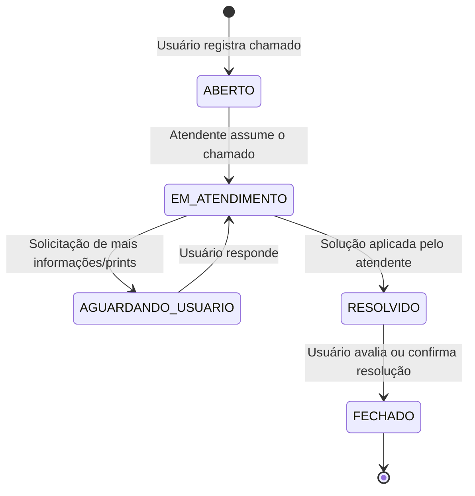

# Módulo de Service Desk & Suporte Integrado

O **Service Desk** do FaturaMed foi desenvolvido para centralizar a comunicação de incidentes técnicos, dúvidas operacionais e solicitações de melhorias entre médicos, equipe administrativa/faturamento e desenvolvedores.

O módulo inclui painel Kanban em tempo real, controle rigoroso de SLA por criticidade, widget flutuante global em estilo *Liquid Glass* e suporte ao perfil de acesso `DEV`.

---

## 1. Visão Geral

- **Acesso ao painel completo:** `http://localhost:8080/chamados.html`
- **Widget de atendimento rápido:** Presente no canto inferior das telas principais (`index.html`, etc.), permitindo envio de chamados sem sair da página de trabalho, capturando automaticamente a URL de origem (`paginaOrigem`).
- **Anexos:** Suporte a arquivos de até 5MB (prints de telas, planilhas `.xlsx`/`.csv`, documentos).
- **Avaliação de Satisfação:** Avaliação de 1 a 5 estrelas e comentário após a resolução do ticket.

---

## 2. Filas de Atendimento e Tipos de Chamados

O sistema divide automaticamente as demandas em duas filas principais:

| Tipo de Chamado | Descrição | Fila Padrão | Prioridade Padrão | SLA Padrão |
| :--- | :--- | :---: | :---: | :---: |
| `ERRO_BLOQUEANTE` | Falha crítica que impede o uso de telas, importação ou conferência. | **DEV** | `CRITICA` | 4 horas |
| `BUG_INCONSISTENCIA` | Comportamento inesperado, erro de cálculo, layout ou divergência técnica. | **DEV** | `ALTA` | 12 horas |
| `DUVIDA_FINANCEIRA` | Dúvidas sobre valores de repasse, conciliação, relatórios ou regras de negócio. | **ADMIN** | `MEDIA` | 24 horas |
| `CADASTRO_ACESSO` | Problemas com login, vínculo de médico, cadastro de hospital ou permissões. | **ADMIN** | `MEDIA` | 24 horas |
| `MELHORIA_SUGESTAO` | Ideias de novos recursos, ajustes visuais ou melhorias de usabilidade. | **DEV** | `BAIXA` | 48 horas |

> [!NOTE]
> Os prazos de SLA e as prioridades podem ser reconfigurados via API (`PUT /api/chamados/tipos/{codigo}`) por administradores ou desenvolvedores.

---

## 3. Perfis de Usuário & Permissões

A migration `V21__service_desk_chamados.sql` adicionou o perfil `DEV` ao controle de acesso:

- **`MEDICO`:**
  - Abre chamados através do widget ou da tela de chamados.
  - Acompanha seus próprios chamados e timeline de respostas.
  - Avalia o atendimento (1 a 5 estrelas) quando o ticket é resolvido.
- **`ADMIN`:**
  - Visualiza e atende chamados da fila `ADMIN` (dúvidas financeiras, cadastros).
  - Pode assumir chamados, transferir para a fila `DEV`, alterar status e adicionar respostas com anexos.
  - Acesso à gestão de usuários e vínculos.
- **`DEV`:**
  - Perfil técnico focado na fila `DEV` (erros bloqueantes, bugs e melhorias).
  - Assume chamados, atualiza prazos, diagnostica inconsistências e fecha incidentes resolvidos.

---

## 4. Ciclo de Vida do Chamado (Fluxo Kanban)

### Indicadores de SLA
O Kanban calcula dinamicamente o status do SLA com base no tempo decorrido:
- 🟢 **No Prazo (`NO_PRAZO`):** Chamado dentro da janela acordada.
- 🟡 **Alerta (`ALERTA`):** Menos de 25% do tempo restante antes do vencimento.
- 🔴 **Vencido (`VENCIDO`):** Prazo estourado.

---

## 5. Endpoints da API REST (`/api/chamados`)

| Método | Endpoint | Perfil | Descrição |
| :--- | :--- | :---: | :--- |
| `GET` | `/api/chamados/tipos` | Autenticado | Lista os tipos de chamados e SLAs configurados. |
| `PUT` | `/api/chamados/tipos/{codigo}` | `ADMIN`, `DEV` | Atualiza SLA, fila padrão ou prioridade do tipo. |
| `GET` | `/api/chamados/atendentes` | `ADMIN`, `DEV` | Lista atendentes disponíveis para atribuição. |
| `GET` | `/api/chamados` | Autenticado | Lista chamados com filtros (`fila`, `status`, `tipo`, `busca`, `meus`). |
| `POST` | `/api/chamados` | Autenticado | Cria novo chamado com upload de anexos (*multipart/form-data*). |
| `GET` | `/api/chamados/{id}` | Autenticado | Detalha chamado, histórico de mensagens e anexos. |
| `POST` | `/api/chamados/{id}/mensagens` | Autenticado | Envia nova mensagem na timeline com anexos opcionais. |
| `POST` | `/api/chamados/{id}/status` | `ADMIN`, `DEV` | Altera status, assume chamado ou transfere fila. |
| `POST` | `/api/chamados/{id}/avaliacao` | Solicitante | Registra nota (1 a 5) e comentário de satisfação. |
| `GET` | `/api/chamados/{id}/anexos/{anexoId}` | Autenticado | Download/visualização segura do anexo. |
